<div align="center">

# GenAI Interactive Playbook

### Neural computation, made observable

An interactive laboratory for university courses on neural networks, NLP and large language models.<br>
Every number on screen comes from a real computation — nothing is animated from canned values.

[](https://mouradmars.github.io/GenAI-Interactive-Playbook/)

[](https://github.com/mouradmars/GenAI-Interactive-Playbook/actions/workflows/pages.yml)


[**Live demo**](https://mouradmars.github.io/GenAI-Interactive-Playbook/) · [Modules](#modules) · [Screenshots](#screenshots) · [Quick start](#quick-start) · [Teaching](#teaching-with-the-playbook) · [Verification](#how-correctness-is-verified) · [Architecture](#architecture)

<br>

<a href="docs/screenshots/03-attention-heatmap.png">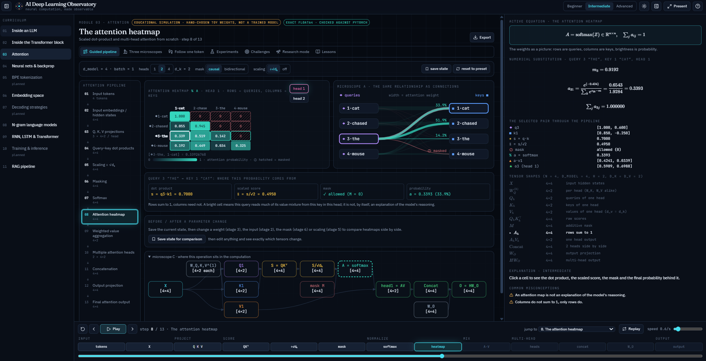</a>

<sub>Module 03 · Attention — click any heatmap cell and every view (token graph, matrices, pipeline, equation) follows it.</sub>

</div>

---

## Why this project

| | |
|---|---|
| 🔬 **Real computation, end to end** | Module 01 runs a small GPT trained in this repository; every tensor is recomputed in the browser from its weights. The other labs compute exactly in float64 from the parameters on screen. |
| ✅ **Verified, not illustrated** | Browser engines are tested against PyTorch (`nn.MultiheadAttention`, `TransformerEncoderLayer`, `scaled_dot_product_attention`), finite differences and hand calculations — 448 unit/app tests and 18 browser tests. |
| 🏷️ **Honest labels** | Every view says whether it shows a *trained model*, an *exact computation* or an *educational simulation*. Nothing presents toy weights as learned behaviour. |
| 🎓 **Built for the classroom** | Guided, explore and challenge modes; three depth levels; step / play / rewind; presentation mode with instructor notes; timed lessons; PNG, JSON and Markdown export. |
| 📦 **Zero backend** | A static site. Runs offline, deploys to GitHub Pages, or ships as one self-contained HTML file. |

## Modules

| # | Module | What students do | Ground truth | Open |
|:-:|---|---|---|:-:|
| 01 | **Inside an LLM** | Follow one prompt through a real GPT: BPE, embeddings, attention, MLP, residual stream (3-D), logits, decoding | Trained model, PyTorch-parity | [▶](https://mouradmars.github.io/GenAI-Interactive-Playbook/#llm) |
| 02 | **Inside the Transformer block** | LayerNorm, Q/K/V, masking, softmax, heads, residuals, MLP; GPT pre-LN vs BERT post-LN; KV cache; precision | Exact float64, PyTorch < 1e-12 | [▶](https://mouradmars.github.io/GenAI-Interactive-Playbook/#transformer) |
| 03 | **Attention** | Scaled dot-product and multi-head attention from scratch, three synchronized microscopes, follow one token, 8 experiments | Exact float64, PyTorch < 1e-12 | [▶](https://mouradmars.github.io/GenAI-Interactive-Playbook/#attention) |
| 04 | **Neural networks & backprop** | Build an MLP, step forward and backward, check every gradient, watch it train, a trained digit classifier | Exact; gradients vs finite differences | [▶](https://mouradmars.github.io/GenAI-Interactive-Playbook/#mlp) |
| 06 | **Embedding space** | Dot products, cosine, analogies, PCA / UMAP distortion, contextual embeddings | Trained PPMI-SVD + real model | [▶](https://mouradmars.github.io/GenAI-Interactive-Playbook/#embeddings) |
| 08 | **N-gram language models** | Counts, smoothing, back-off, Kneser-Ney and perplexity on your own corpus | Exact, distributions sum to 1 | [▶](https://mouradmars.github.io/GenAI-Interactive-Playbook/#ngram) |
| 09 | **RNN, LSTM & Transformer** | Recurrence, LSTM gates, self-attention, BPTT, vanishing gradients, real training results | Trained models, PyTorch-parity | [▶](https://mouradmars.github.io/GenAI-Interactive-Playbook/#rnn) |
| 11 | **RAG pipeline** | Chunking, TF-IDF / BM25 / dense retrieval, hybrid fusion, reranking, prompts, citations, failure analysis | Exact retrieval; generator labelled as simulated | [▶](https://mouradmars.github.io/GenAI-Interactive-Playbook/#rag) |
| 05 · 07 · 10 | BPE tokenization · Decoding strategies · Training & inference | — | *planned* | |

## Screenshots

<table>
<tr>
<td width="50%"><a href="docs/screenshots/01-llm-attention-weights.png">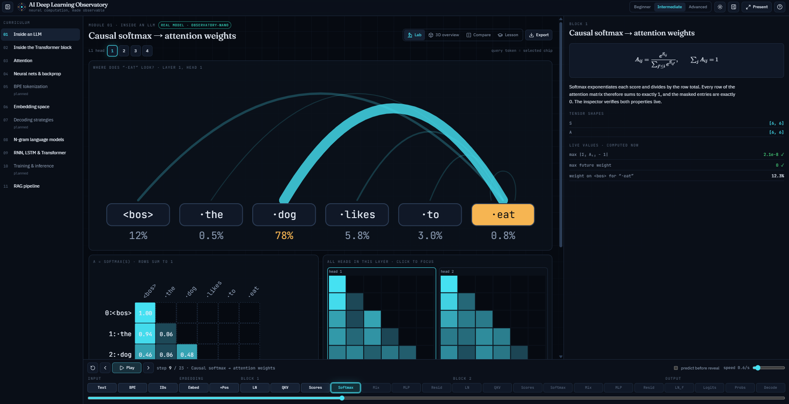</a><br><sub>01 · Inside an LLM — causal softmax and attention weights of the real model</sub></td>
<td width="50%"><a href="docs/screenshots/01-llm-residual-stream-3d.png">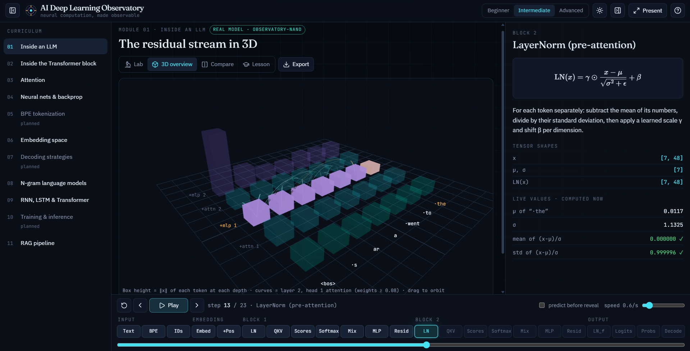</a><br><sub>01 · Inside an LLM — the residual stream in 3-D</sub></td>
</tr>
<tr>
<td><a href="docs/screenshots/02-transformer-attention-mask.png">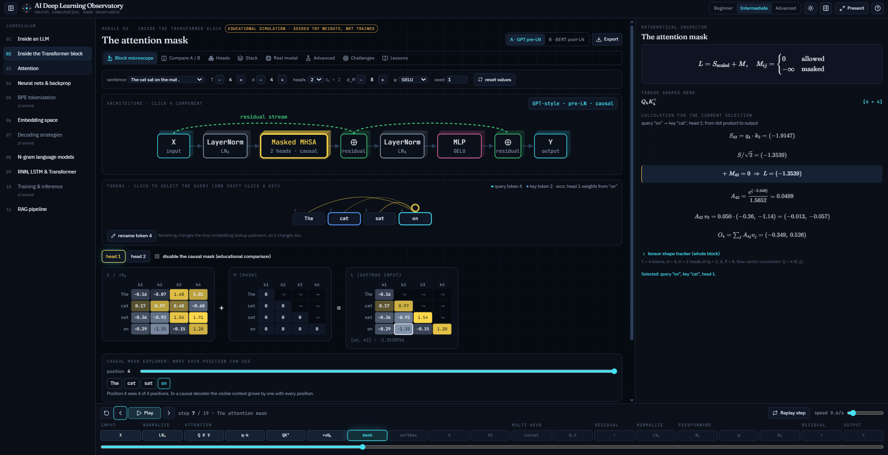</a><br><sub>02 · Transformer block — the causal mask, with the full calculation in the inspector</sub></td>
<td><a href="docs/screenshots/03-attention-dot-products.png">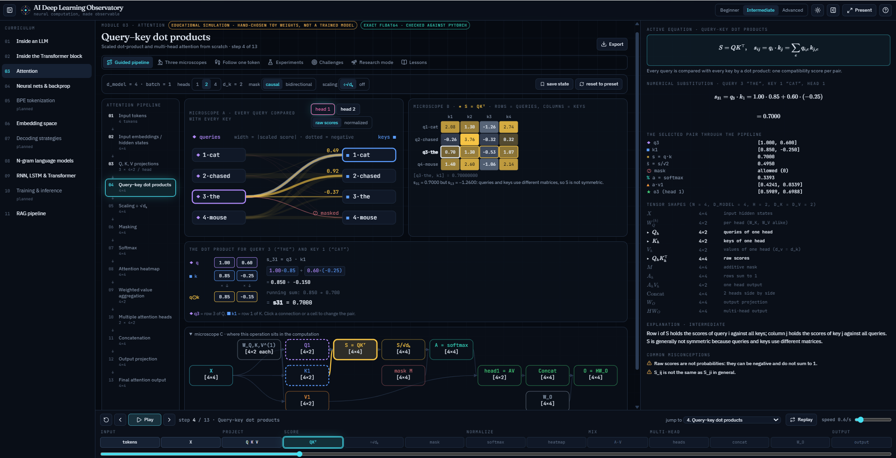</a><br><sub>03 · Attention — query–key dot products: token graph, score matrix and term-by-term sums</sub></td>
</tr>
<tr>
<td><a href="docs/screenshots/04-neural-network-architecture.png">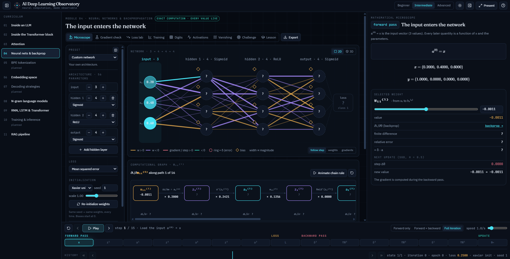</a><br><sub>04 · Neural networks — a custom MLP, its computational graph and the chain rule</sub></td>
<td><a href="docs/screenshots/04-neural-network-forward-pass.png">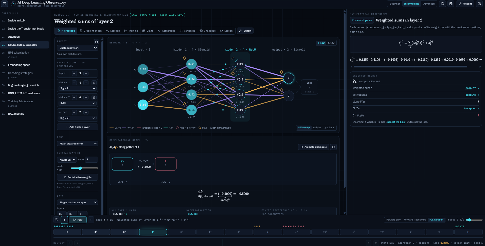</a><br><sub>04 · Neural networks — the forward pass, neuron by neuron</sub></td>
</tr>
<tr>
<td><a href="docs/screenshots/06-embeddings-pca-3d.png">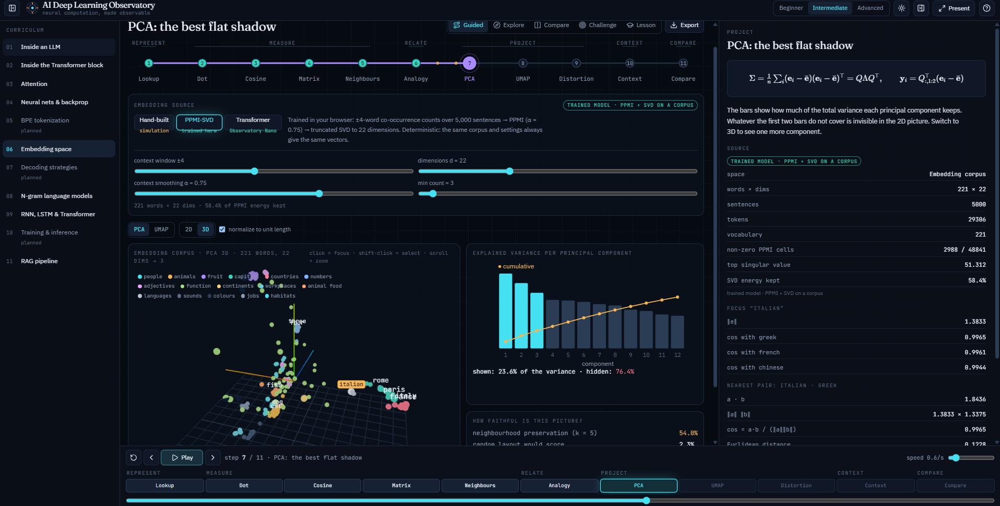</a><br><sub>06 · Embedding space — PCA in 3-D with explained variance and faithfulness</sub></td>
<td><a href="docs/screenshots/08-ngram-kneser-ney.png">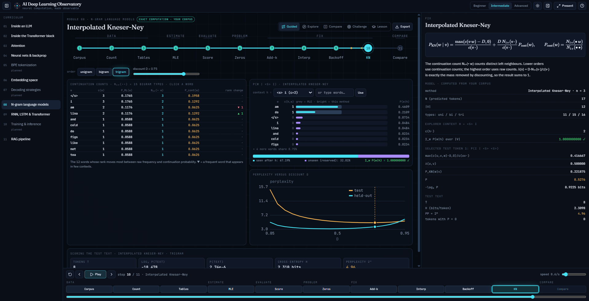</a><br><sub>08 · N-gram models — interpolated Kneser-Ney and perplexity vs discount</sub></td>
</tr>
<tr>
<td><a href="docs/screenshots/11-rag-knowledge-base.png">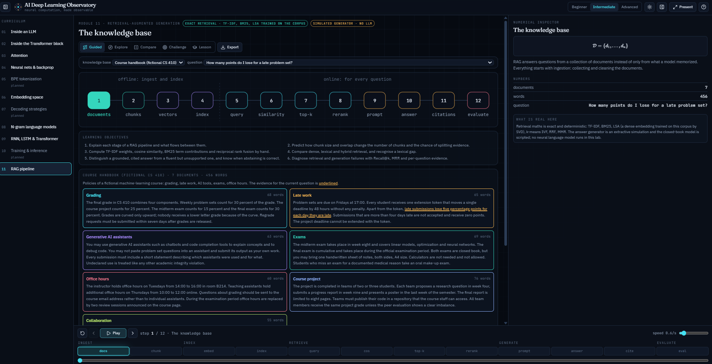</a><br><sub>11 · RAG pipeline — the knowledge base and learning objectives</sub></td>
<td><a href="docs/screenshots/11-rag-top-k-retrieval.png">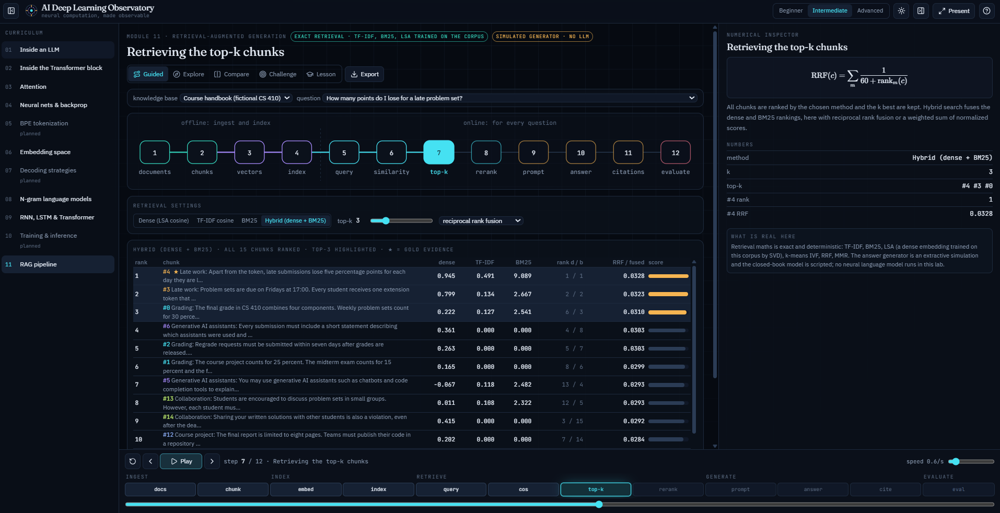</a><br><sub>11 · RAG pipeline — hybrid retrieval with reciprocal rank fusion</sub></td>
</tr>
<tr>
<td><a href="docs/screenshots/09-rnn-lstm-transformer.png">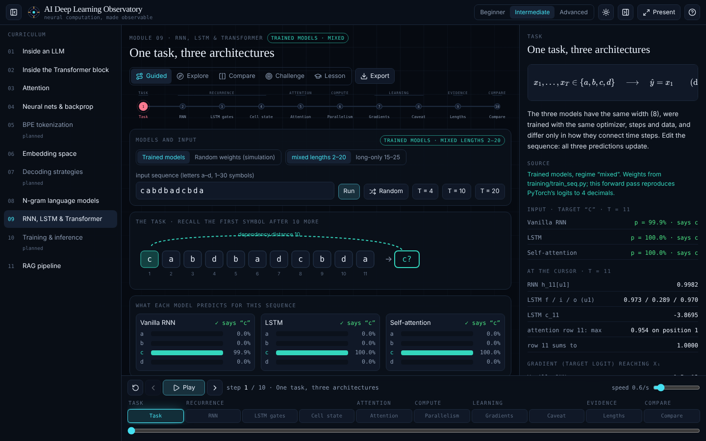</a><br><sub>09 · RNN, LSTM & Transformer — one task, three architectures</sub></td>
<td></td>
</tr>
</table>

## Quick start

**Requirements:** Node.js 20+ (CI uses 22).

```bash
git clone https://github.com/mouradmars/GenAI-Interactive-Playbook.git
cd GenAI-Interactive-Playbook
npm install
npm run dev            # → http://localhost:5173  (deep links: /#attention, /#rag, …)
```

Or skip the setup entirely: open the [live demo](https://mouradmars.github.io/GenAI-Interactive-Playbook/).

| Script | What it does |
|---|---|
| `npm run dev` | Development server with hot reload |
| `npm test` | Unit, numerical and interaction tests (Vitest + Testing Library) |
| `npm run test:e2e` | Browser tests (Playwright; `PW_CHROMIUM=/path/to/chrome` to use a local Chromium) |
| `npm run build` | Static site in `dist/` |
| `npm run build:single` | One self-contained HTML file in `dist-single/` |
| `npm run train` | Retrain Observatory-Nano (Python 3.10+, `torch`, `numpy`; ≈1–2 min on a laptop CPU) |

<details>
<summary>Regenerating the PyTorch references and trained artefacts</summary>

| Command | Produces | Needs |
|---|---|---|
| `npm run train` | `src/data/nano-model.json`, `nano-reference.json` | `torch`, `numpy` |
| `python3 training/block_reference.py` | `src/data/block-reference.json` (module 02) | `torch`, `numpy` |
| `python3 training/attention_reference.py` | `src/data/attention-reference.json` (module 03) | `torch`, `numpy` |
| `python3 training/train_digits.py` | `src/data/digits.json` (module 04, ≈10 s) | `numpy`, `scikit-learn` |

</details>

## Teaching with the playbook

Every module shares the same workspace: a **stage** in the centre, a **mathematical inspector** on the right (active equation, numerical substitution, tensor shapes, explanation, misconceptions) and an **execution timeline** at the bottom.

| Key | Action | | Key | Action |
|:-:|---|---|:-:|---|
| <kbd>→</kbd> / <kbd>←</kbd> | Step forward / back | | <kbd>F</kbd> | Presentation mode (fullscreen, instructor notes) |
| <kbd>Space</kbd> | Play / pause | | <kbd>T</kbd> | Dark ↔ projector (light) theme |
| <kbd>Home</kbd> | Reset | | <kbd>N</kbd> / <kbd>I</kbd> | Hide modules / inspector |
| <kbd>1</kbd> <kbd>2</kbd> <kbd>3</kbd> | Beginner · intermediate · advanced | | <kbd>E</kbd> | Export PNG / JSON / Markdown |
| <kbd>R</kbd> | Replay the current operation | | <kbd>?</kbd> | All shortcuts |

Modules 02, 03 and 04 include **timed classroom lessons** (15–25 minutes each) with instructor notes, discussion questions, short exercises and one-click “Show me” demonstrations.

## How correctness is verified

| Engine | Reference | Highlights |
|---|---|---|
| `engine/model.ts` (01) | PyTorch forward pass of the trained GPT | identical BPE ids, logits within 2e-3, attention to 4 decimals |
| `engine/block.ts` (02) | `nn.TransformerEncoderLayer`, `nn.MultiheadAttention` | 6 configurations below 1e-12; causality, equivariance, KV cache |
| `engine/attention.ts` (03) | `nn.MultiheadAttention`, `F.scaled_dot_product_attention` | 13 configurations below 1e-12; changing V never changes A |
| `engine/nn.ts` (04) | central finite differences | every parameter, 22 activation/loss combinations, error < 1e-7 |
| `engine/embeddings.ts` (06) | hand computations, Jacobi eigensolver | W Wᵀ = M Mᵀ, analogies quoted in lessons |
| `engine/ngram.ts` (08) | textbook values | every smoothed distribution sums to exactly 1 |
| `engine/seq.ts` (09) | PyTorch forward pass, finite differences | 6 trained models; BPTT for all architectures |
| `engine/rag.ts` (11) | hand computations | chunk counts, TF-IDF, BM25, LSA, RRF, MMR, citations |

<details>
<summary><b>Full test inventory</b></summary>

- `training/train.py` builds a deterministic toy corpus, trains BPE (`training/bpe.py`) and the GPT, then exports weights (`src/data/nano-model.json`) and PyTorch reference activations (`src/data/nano-reference.json`).
- `src/engine/` reimplements tokenization and the forward pass in TypeScript. The tests check that the browser matches PyTorch: identical token IDs, identical BPE merges, last-position logits within 2e-3, attention weights to 4 decimals, the same top-1 prediction, plus invariants (causal mask, row sums, softmax stability, LayerNorm moments, decoding filters, seeded reproducibility).
- `src/engine/rag.test.ts` (22 tests) checks the RAG engine: stemming, stop words, sentence splitting and query rewriting; fixed-window chunk counts against ⌈(n − o)/(s − o)⌉ with full coverage and exact overlap; sentence packing keeping whole sentences; gold-span split detection (and overlap fixing it); TF-IDF and BM25 against hand computations; LSA reproducing the Gram matrix and TF-IDF dot products at full rank, deterministic and ordered when truncated; RRF and weighted fusion by hand; seeded k-means, IVF with all probes equal to exact search; MMR (λ = 1 keeps the order); the strict rank-order prompt budget; verbatim, verified citations; abstention on every unanswerable question; and the behaviours quoted in the lessons (lexical gaps fixed by rewriting, the reasoning failure, both Pluto pages retrieved, the MMR example, the split example).
- `src/modules/rag/rag.module.test.ts` (7 tests) checks the corpora (each gold span occurs in exactly one document), example 1, the store with added documents and custom questions, challenge answers against the engine for 30 seeds, and the failure diagnoses. `src/test/rag.app.test.tsx` (9 tests) and `e2e/rag.spec.ts` (3 Playwright tests) drive the UI: stepping, chunking controls, method switching, grounded vs closed-book answers and abstention, the lexical-gap example, citations and evaluation, custom documents and questions, explore and compare, challenge scoring, play/pause, export, and phone width.
- `src/engine/block.test.ts` (29 tests) checks the Transformer-block engine: matmul/transposes, the brief's dot product 0.42, LayerNorm moments and γ/β, stable softmax (shift invariance, exact zeros under −∞, no overflow), erf/GELU to 1e-12, the causal mask; **PyTorch parity below 1e-12 for six configurations** (pre-LN causal GELU, post-LN bidirectional ReLU, SwiGLU, interventions with a disabled head, scaled sublayers and disabled units, a larger d = 8 / 4-head block, post-LN causal), where `training/block_reference.py` also checks the four standard ones against `torch.nn.TransformerEncoderLayer` and `nn.MultiheadAttention`; shape consistency; rows summing to 1 with exact future zeros; residual identities; causality (changing a later token never changes earlier outputs); permutation equivariance of the bidirectional block; ablations; post-LN normalization; fp32/bf16/fp16 error ordering; stacks; KV-cache decoding equal to full attention with fewer MACs; T² cost growth; the √dₖ variance argument; and the measured attention-vs-MLP dependency maps (MLP exactly diagonal, causal attention lower-triangular).
- `src/modules/tblock/tblock.test.ts` (7 tests) and `src/test/tblock.app.test.tsx` (10 tests) check stage lists for both architectures, store shape rules, token relabelling, the mask toggle semantics, challenge answers against the engine (25 seeds) and answer formats, and drive the UI: stepping, navigator jumps, the dot-product formula and synchronized chain, token selection, row sums, the mask toggle, weight editing and reset, residual and MLP interventions, preset B's reordered block, all tabs, the real model, challenge checking and verify, lesson demos and the calculation sheet. `e2e/tblock.spec.ts` (4 Playwright tests) repeats the key flows in Chromium, including presentation mode and phone width.
- `src/engine/nn.test.ts` (61 tests) checks the neural-network engine: activation derivatives against finite differences (ReLU′(0) = 0 stated); softmax shift invariance and its Jacobian; the worked example by hand (z = 0.36 exactly, a = 0.5890, ŷ = 0.5404, L = 0.2112, δ², ∂L/∂w₁₁⁽¹⁾); **backpropagation against central finite differences for every parameter in 22 activation/loss combinations** (all five hidden activations × sigmoid/MSE, linear/MSE, sigmoid/BCE, softmax/CCE, plus a deep 3-4-4-2 network), max error < 10⁻⁷; the sigmoid + BCE and softmax + CCE simplifications equal the generic chain; stable losses at logits ±500; **the sum over all chain-rule paths equals the backprop gradient** for every parameter (deep and softmax networks) and for activations; path counts; batch gradients as sample means; SGD, momentum and Adam (first step ≈ η) formulas; seeded initialization, Xavier bounds, epoch shuffles; exact replay of training from any recorded snapshot; XOR unsolvable without a hidden layer and solved with one; configuration rules.
- `src/engine/digits.test.ts` (12 tests) checks the digit data and split, browser logits/probabilities against the NumPy reference (6–7 decimals), test accuracy 97.3 %, test loss and the confusion matrix against the exported metrics, the over-fitting shape of the training curve, gradient checks on the trained network, that following the saliency raises p(true class), and the depth diagnostics (deep sigmoid gradients vanish > 1000×, ReLU + He stay within 100×, large weights explode δ > 100×, saturation and dead fractions, Frobenius norms).
- `src/modules/mlp/model.test.ts` (33 tests) checks presets, configuration repair, the micro-step timeline and reveal logic, chain-path node/edge construction, the narration's substituted numbers, and the store: one committed update equals `applyUpdate`, rewind + branch equals a fresh replay, training equals `trainStep`, edits/revert/record, architecture rebuilds, that the XOR, AND and two-moons presets actually learn, every vanishing-lab preset's verdict and the training race, challenge determinism and answers (including path counts verified with `chainPaths`), and the measured activation properties.
- `src/test/mlp.app.test.tsx` (15 tests) and `e2e/mlp.spec.ts` (7 Playwright tests in Chromium) drive the UI: forward stepping with real numbers, reveal-gated inspector values, backprop = path sum = finite difference for w₁₁⁽¹⁾, applying an update and rewinding, manual edits and revert, the builder's compatibility repairs, 9/9 and 1482/1482 gradient checks, the lesson buttons, XOR training, the 3-D toggle, clicking neurons and connections, no horizontal scroll at phone width, the digit lab (trained label, mistakes, drawing a “1” that is classified as 1, tracing it, relabelling after an edit), activations, the vanishing verdicts, challenge scoring and the lesson links.
- `src/engine/ngram.test.ts` (64 tests) checks the n-gram engine: the textbook bigram probabilities (P(i|&lt;s&gt;) = 2/3, P(am|i) = 2/3, …), sentence probability and perplexity, infinite perplexity for unseen bigrams, every smoothed method summing to exactly 1 over V for 4 methods × 3 orders × 3 corpora × seen, unseen and `<unk>` contexts, add-k with k = 0 equalling MLE, hand computations of bigram and trigram Kneser-Ney (all three levels), the continuation-count identities Σ_w N₁₊(•w) = N₁₊(••) and Σ_w N₁₊(•vw) = N₁₊(•v•), backoff α redistributing exactly the discounted mass, discount clamping (d = 1 never zeroes a seen n-gram), seeded generation and challenge determinism, and λ tuning.
- `src/engine/embeddings.test.ts` (26 tests) checks the embedding engine: dot/cosine identities and scale invariance; the Jacobi eigensolver (reconstruction, orthonormality, trace) and agreement of the fast Householder + QL solver with it; PCA on a known line; Spearman and neighbourhood preservation (1 for a distance-preserving map); PPMI against a hand computation; W Wᵀ = M Mᵀ for the SVD embedding; deterministic training; the trained-space facts quoted in the lessons (paris : france :: rome : italy is rank 1 with ±4 and rank 8 with ±1; princess beats queen); UMAP determinism per seed; contextual embeddings equal to a direct forward pass; seeded, self-consistent challenges.
- `src/engine/seq.test.ts` (26 tests) checks the sequence engine: forward parity with PyTorch for all six trained models; LSTM identities (c_t = f⊙c_{t−1} + i⊙g, h_t = o⊙tanh c_t, gates in (0, 1)); attention rows summing to 1 with exact causal zeros; backpropagation through time against central finite differences for all three architectures, random and trained, for both the loss and the target-logit objective; vanishing/exploding behaviour vs recurrent scale and forget bias; the training outcomes quoted in the lessons; browser re-evaluation agreeing with Python; occlusion; attention-vs-occlusion agreement (trained agrees, a random model disagrees); the cost formulas and schedule; seeded, self-consistent challenges.
- `src/test/seq.app.test.tsx` (10 tests) drives the sequence UI: stage stepping, the source label switching to simulation, sequence editing (including shortening it), the independent time cursor, the LSTM stage, the gradient objective and scale slider, the caveat stage, in-browser re-evaluation, challenge checking, examples, compare, the quiz and the export report.
- `src/test/embed.app.test.tsx` (10 tests) drives the embedding UI: stepping and shortcuts, dot-product presets and typed components, cosine invariance under scaling, the word chips, metric switching, analogies, projection and distortion stages, contextual embeddings, challenge checking, compare, the quiz and the export report.
- `src/test/ngram.app.test.tsx` drives the n-gram UI: stepping, keyboard shortcuts, live parameter edits, corpus editing, examples, the counting window, challenge checking, A/B and the quiz.
- The model's knowledge is limited to its corpus (animals and their food, ten capitals, colors, counting, walks to places). It is labelled as a real trained model in the UI because it is one; nothing is hand-set.

</details>

## Architecture

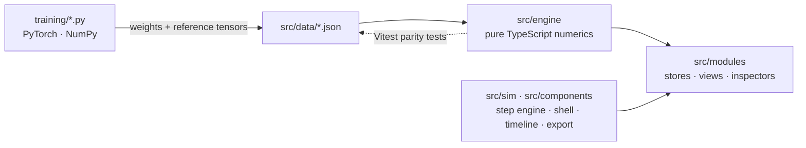

**Design principles**

- **The engine is the single source of truth.** Views only display engine traces and write selections or edits back to a store; they never compute model values themselves.
- **Deterministic by construction.** Seeded generators everywhere: the same seed gives the same weights, samples, challenges and replays.
- **One workspace, many modules.** A shared step engine (pure reducer + hook), shell, timeline, inspector layout and export dialog keep every lab consistent.

<details>
<summary><b>Source tree</b></summary>

```
src/
  engine/        numerical code only (tensor ops, BPE, NanoGPT forward + logit lens, decoding,
                 linalg + embeddings for module 06, n-gram models for module 08,
                 seq.ts for module 09: RNN/LSTM/attention forward, BPTT, occlusion, cost model,
                 rag.ts for module 11: chunking, TF-IDF, BM25, LSA, IVF, fusion, MMR, prompts, extractive
                 generation, citation checks, evaluation;
                 attention.ts for module 03: Q/K/V, masks, stable softmax, multi-head, cross-attention, scaling
                 experiment, head similarity, cost model;
                 block.ts for module 02: Transformer block (LN, attention, MLP, pre/post-LN), precision
                 emulation, KV cache, cost model, stacks, dependency maps;
                 nn.ts for module 04: MLP forward/backward, losses, gradient check, chain paths,
                 optimizers, datasets, seeded training, depth diagnostics; digits.ts: trained classifier)
  sim/           shared step engine (pure reducer + hook) and app state (theme, depth, panels)
  components/    shell, workspace layout, timeline, export dialog, SVG viz, 3D views (R3F)
  modules/
    registry.ts  curriculum
    llm/         journey (step list), lesson text, stage views, inspector, compare, lesson panel
    embed/       module 06: lesson text, examples, scatter (SVG + R3F), stage views, panels, lab state
    seq/         module 09: lesson text, examples, LSTM cell diagram, stage views, panels, lab state
    rag/         module 11: store, stages + lessons, pipeline strip, stage views, inspector, explore/compare/
                 challenge/lesson panels, failure diagnosis
    attn/        module 03: zustand store, stages, navigator, token graph (microscope A), pipeline view (C), stage
                 views, inspector, microscopes/follow/experiments/challenges/research/lessons tabs, export sheet,
                 real-model adapter
    tblock/      module 02: zustand store, stage list + explanations, navigator, token bar, stage views,
                 inspector, compare/heads/stack/real-model/advanced labs, challenges, lessons, calc sheet
    mlp/         module 04: zustand store (config, params, history, micro-step cursor), pure model helpers
                 (presets, repair, micro-steps, chain paths), narration, network (SVG + R3F), computational
                 graph, inspector, timeline, gradient checker, loss lab, training panel, digits,
                 activations, vanishing lab, challenges, lesson
    ngram/       module 08
  data/          trained weights + references, rag-corpora.ts (module 11 knowledge bases)
e2e/             Playwright browser tests
training/        corpora, BPE trainer, PyTorch training/export script, embed_corpus.py (module 06 corpus),
                 train_seq.py (module 09: trains the RNN, LSTM and attention models, ≈2 min on CPU),
                 block_reference.py (module 02: PyTorch reference tensors),
                 train_digits.py (module 04: the 8×8 digit classifier, NumPy, ≈10 s)
```

Lesson text (`modules/llm/lesson.ts`), numerical computation (`engine/`), visualization (`components/`, `StageViews.tsx`) and UI state (`sim/`) are separate. New modules plug into the same `useStepEngine`, `Workspace`, `Timeline` and inspector pattern.

</details>

**Stack:** React 19 · TypeScript · Vite · Tailwind CSS 4 · Zustand · D3 / SVG · React Three Fiber · KaTeX · Framer Motion · Vitest · Testing Library · Playwright · PyTorch / NumPy for training and references.

## Module guide

Detailed notes for each lab — what every stage shows, the experiments, challenges and lessons.

<details>
<summary><b>01 · Inside an LLM</b></summary>

23 steps through one forward pass of **Observatory-Nano** (2 layers, 4 heads, d_model 48, 178-token BPE vocabulary, 75k parameters):

text → BPE merges → token IDs → embedding lookup (with a 3D PCA of all 178 embeddings) → positional embedding → per block: LayerNorm, Q/K/V, scaled scores with causal mask (click a cell for the dot product term by term), softmax and attention arcs, value mixing + W_O + residual, MLP with GELU curve and neuron map, logit lens → final LayerNorm → logits → probabilities → decoding (greedy, temperature, top-k, top-p, seeded sampling) → append and re-run.

- **Views:** Lab (step-by-step), 3D overview (residual stream lattice with attention flows), Compare (two prompts/decoding configs side by side, 10 generated tokens each), Lesson.
- **Teaching:** objectives, guided walkthrough, four worked examples, three live exercises, misconception warnings, a graded assessment, predict-before-reveal mode with discrepancy explanations.
- **Depth levels:** beginner (intuition), intermediate (worked numbers), advanced (shapes, derivations, raw tensor slices).
- **Inspector:** KaTeX equation, tensor shapes, live checks (row sums = 1, masked weights = 0, LayerNorm mean/std, Σp = 1, entropy).
- **Export:** PNG snapshot of the main visualization, step data as JSON (including the full current tensor), and a Markdown classroom report.
- **Shortcuts:** ←/→ step, Space play, Home reset, 1/2/3 depth, T theme, F present (fullscreen), N/I panels, P predict, E export, G 3D, ? help.

</details>

<details>
<summary><b>02 · Inside the Transformer block</b></summary>

Open `http://localhost:5173/#transformer`. One Transformer block, computed exactly in float64 by `src/engine/block.ts`, with every intermediate tensor on screen. Default: the brief's toy model — 4 tokens of “The cat sat on the mat .”, d = 4, 2 heads (dₖ = 2), d_ff = 8, GELU — with seeded one-decimal weights (badge: *educational simulation · seeded toy weights, not trained*). T (2–10), d (2–8), heads (divisors of d), d_ff, activation and seed are configurable; shapes stay valid.

- **Two architectures, explicitly different:** Preset A, decoder-only GPT-style pre-LN with a causal mask (H = X + Attn(LN₁(X)), Y = H + MLP(LN₂(H))), the main lesson; Preset B, encoder BERT-style post-LN, bidirectional (H = LN₁(X + Attn(X)), Y = LN₂(H + MLP(H))). The selected architecture is labelled at all times; the stage list itself changes (19 vs 17 stages).
- **Five synchronized regions:** architecture navigator (clickable, depth-shaded block diagram with the residual stream), mathematical inspector (equation, tensor shapes, the calculation for the current selection, value editing, whole-block shape tracker), token & attention explorer (selectable/renamable tokens, attention arcs from the query token), execution timeline (step, play, pause, reset, speed, jump, replay operation), and an explanation panel answering the five questions for every operation.
- **Stages:** input hidden states (with an optional upstream view X = E[token] + P[position]; nothing positional is re-added inside the block) → LayerNorm microscope (original → μ → centre → σ² → normalize → γ, β, animated, with γ/β/ε/input sliders and a per-token table) → Q/K/V factory (click any output cell: row × column products and running sum; edit any weight) → one query–key dot product → score matrix → scaling by √dₖ (with a measured variance table) → mask (causal mask explorer; an educational toggle disables it with a warning) → stable softmax (logits, minus max, exp, sum, probabilities; every row checked) → attention weights (all heads, cell details) → weighted value aggregation (each contribution and stacked bars) → concatenation (head-coloured columns, head toggles) → output projection → residual addition (scale or disable the contribution; post-LN shows the LayerNorm after the sum) → LN₂ → MLP expand / activation (ReLU, GELU, SiLU, or SwiGLU clearly labelled as a different, gated architecture) / project back (per-token network drawing, click hidden units to disable them, the same MLP shown for every position) → second residual (complete trace of one token: X + attention update + MLP update = Y) → output (still a hidden state; an LM head is needed for probabilities).
- **Synchronization:** clicking a score or attention cell selects the query and key everywhere; the inspector shows the whole chain for that pair, q·k → ÷√dₖ → + M → softmax → A·v contribution → O.
- **Compare A / B:** both block orders, a table of differences, causal vs bidirectional heatmaps and output statistics on the same input and weights.
- **Heads:** head chambers side by side, isolate/enable, overlaid attention arcs, Concat · W_O with exact shapes, and the ablation challenge (‖Y without head h − Y‖ per token). No claim that heads have fixed linguistic jobs.
- **Stack:** 1–6 blocks with their own weights, per-block attention, hidden-state norms, feature values across blocks, PCA trajectories (labelled as an approximation, with the variance kept), block disabling, and “open in the microscope” for any block.
- **Real model:** Observatory-Nano (the trained 2-block, 4-head GPT of module 01, verified against PyTorch): your text, tokenization, actual attention per block and head, 48-dimensional hidden states, what each block writes into the residual stream, and the next-token distribution after the final LayerNorm, LM head and softmax. Nothing invented; attention is not presented as an explanation.
- **Advanced:** attention vs MLP measured dependency maps (lower-triangular vs exactly diagonal), residual stream contributions, KV-cache decoding (cached keys/values, the new query's weights, equality with full attention, MAC counts), cost vs sequence length (linear vs T² parts, attention matrix size), numerical precision (every tensor rounded to fp32, bf16 or fp16; errors per tensor).
- **Challenges:** ten seeded, progressive challenges (tensor shapes, a dot product, scaling, causal visibility, softmax, value aggregation, residual addition, a small MLP, encoder vs decoder, and a value of the live simulator), each with check answer, retry, step-by-step solution, explanation, a common misconception and “verify in the simulator”.
- **Lessons and presentation:** Lesson 1 “What happens inside a Transformer block?” (15 min), Lesson 2 “Self-attention, step by step” (25 min), Lesson 3 “From attention to contextual representations” (20 min), each segment with instructor notes and a “Show me” demo; presentation mode (F) hides the configuration, enlarges equations and shows an instructor note per stage; keyboard ←/→, Space, Home, R (replay), E (export).
- **Export:** PNG of the main diagram, JSON of every tensor and parameter, and a Markdown calculation sheet (all intermediate matrices plus the selected attention chain).

</details>

<details>
<summary><b>03 · Attention — scaled dot-product and multi-head attention from scratch</b></summary>

Open `http://localhost:5173/#attention` (or `dist-single/index.html#attention`). Every number comes from `src/engine/attention.ts` (float64, row-vector convention Q = XW_Q, K = XW_K, V = XW_V, A = softmax(QKᵀ/√dₖ + M), MultiHead(X) = Concat(head₁ … head_h) W_O). The default is the brief's educational configuration: n = 4 tokens (the window *cat · chased · the · mouse* of “The cat chased the mouse.”, explained on screen), d_model = 4, h = 2, dₖ = d_v = 2, batch 1, with hand-chosen one-decimal hidden states and projections (badge: *educational simulation · hand-chosen toy weights, not a trained model*). X, W_Q, W_K, W_V and W_O are editable with validation; n (2–8), h (1, 2, 4), causal/bidirectional/padding/custom masks and scaling are switchable.

- **Layout:** pipeline navigator (13 selectable operations with output shapes) · main visualization · mathematical microscope (active equation, numerical substitution for the selected query/key/head, the pair's intermediate values, tensor shape table, explanation at beginner/intermediate/advanced depth, misconceptions) · execution controls (step back/forward, play, pause, reset, replay, speed, scrubber, jump to operation).
- **Operations:** tokens (editable sentence, window, `<pad>` tokens; text token vs embedding vs position vs hidden state) → X (hand-configured, or toy embedding + sinusoidal position) → Q/K/V projection factory (three pathways, step animation, click any output cell for its products and running sum, per-head matrix editors) → query–key dot products (token graph with raw/normalized toggle, aligned element-wise products, S matrix) → √dₖ scaling (live S vs S̃, plus a seeded N(0, 1) experiment for dₖ = 1…1024: histograms, Var ≈ dₖ, entropy, max probability, softmax-Jacobian norm, and a logit-multiplier sensitivity demo) → masking (causal, bidirectional, padding, combined, click-to-knock-out custom cells; fully masked rows return zeros and are flagged, never NaN) → softmax microscope (logits → minus max → exp → Σ → probabilities, row-sum checks, a nudge sandbox for competition and saturation) → heatmap (hover, click, dot product / scaled score / mask / probability per cell, synchronized graph, before/after and difference heatmaps) → weighted value aggregation (2-D vector plane with tip-to-tail contributions, per-dimension sums, knock-outs that renormalize, what-if logit nudges, W_V editing) → multi-head explorer (head chambers, compare two heads with difference, JS divergence, total variation, entropy and output contributions, overlay, ablation, h = 1/2/4) → concatenation → output projection (cell microscope split by head, per-head contributions head_h W_O^(h) summing to O) → final output.
- **Three synchronized microscopes:** one heatmap click updates the token graph (A), the matrix chain Q, K, S, S̃ + M, A, V, head output (B), and the computational pipeline with shapes (C), plus an eight-step account of the selected weight.
- **Follow one token:** a 12-step paused, rewindable journey (input → query projection → comparison with all keys → scores → scaling → masking → softmax → weights → weighted values → head output → concatenation → output projection) with equations, substituted numbers and highlighted cells.
- **Eight experiments** (hypothesis, prediction, run, visual and numerical result, explanation, reset, open in the lab): change W_Q, W_K (scores of keys with x_j,2 = 0 provably stay put), W_V (weights unchanged), remove scaling, toggle the causal mask (last row unchanged), change h (same parameter count), disable a head, compare two inputs. Any edit can also be compared against a saved state tensor by tensor.
- **Challenges:** 15 seeded exercises in three levels (identify Q/K/V and positions, read a heatmap, masked positions; dot product, scaled score, applying a causal mask, softmax, weighted sum; shapes, a live head output, concatenation, output projection, diagnosing a wrong calculation, predicting the effect of changing V), with numeric/vector/shape entry, hints, worked solutions, retry and session progress.
- **Research mode:** entropy per query and head, head ablation table, head similarity, cost vs sequence length (toy and GPT-2-small-like sizes), cross-attention (queries from X, keys/values from a second sequence), and a clearly labelled **real model**: attention matrices of Observatory-Nano, recomputed from its real q and k by this engine to ≈1e-8.
- **Classroom:** Lesson 1 “Understanding Q, K and V” (15 min), Lesson 2 “Scaled dot-product attention from scratch” (25 min), Lesson 3 “Multi-head attention and output projection” (20 min), with instructor notes, discussion questions, short exercises and one-click demos; presentation mode (F) with larger type, instructor notes and hideable panels (N, I); projector theme (T); H switches head, R replays, E exports PNG heatmaps, Markdown calculation sheets and JSON tensors.
- **Verification:** `training/attention_reference.py` runs 13 configurations through PyTorch (`nn.MultiheadAttention` and `F.scaled_dot_product_attention` agree with the explicit computation to 1e-12); `src/engine/attention.test.ts` (36 tests) checks parity on all of them plus the invariants (rows sum to 1, masked entries exactly 0, changing only V never changes A, changing Q or K can, concatenated width h·d_v, output width d_model, deterministic replay, head ablation, cross-attention, scaling statistics, cost model). `src/modules/attn/attn.module.test.ts` (21), `src/test/attn.app.test.tsx` (15) and `e2e/attn.spec.ts` (4 Playwright tests) cover the store, follow steps, inspector substitutions, exports, every experiment's claim, every challenge's answer checking, the real-model cross-check, and the UI flows end to end.

</details>

<details>
<summary><b>04 · Neural networks & backpropagation</b></summary>

Open `http://localhost:5173/#mlp` (or **04 Neural nets & backprop** in the left rail). Badge: *exact computation · every value live*. You build a network and every activation, derivative, gradient and update is computed exactly by `src/engine/nn.ts`; the animation never computes a value of its own. The one trained model is the digit classifier, labelled as such (and relabelled *your weights* as soon as you change or retrain it).

**Layout.** Left: configuration (presets, layer builder, activations, loss, seeded initialization, data, optimizer). Centre: the clickable network (2-D, or 3-D with G) and the computational graph of the selected element. Right: the Mathematical Microscope (the current step's formula with the real numbers substituted, then the selected neuron / weight / bias). Bottom: the learning timeline.

- **Network builder:** 1–6 hidden layers, 1–16 neurons per hidden layer, up to 64 inputs/outputs; sigmoid, tanh, ReLU, leaky ReLU, linear, softmax (output only); MSE, binary cross-entropy (sigmoid outputs), categorical cross-entropy (softmax, ≥ 2 outputs). Incompatible combinations are repaired automatically and every repair is explained. Xavier / He / uniform / normal initialization with a seed and scale (same seed → same weights). Manual weight edits by slider or number, with *compare on network*, *revert* and *record edit*. Presets: 2 → 2 → 1 worked example, single neuron (AND), 2 → 3 → 2 → 1 (XOR), 2 → 8 → 8 → 1 (two moons), 3 → 4 → 4 → 2 softmax, 64 → 16 → 16 → 10 trained digit classifier (inputs drawn as an 8×8 grid).
- **Forward microscope:** micro-steps x → z¹ → a¹ → … → ŷ → L. Values appear only after the step that computes them; pulses move along the connections being used; the inspector writes out z = Σ w·a + b term by term with the actual numbers.
- **Backpropagation microscope:** δᴸ (generic chain, or the exact ŷ − y simplification for sigmoid + BCE and softmax + CCE, shown next to the generic result) → ∂L/∂Wᴸ = δᴸ aᴸ⁻¹ᵀ → δ⁽ˡ⁾ = (W⁽ˡ⁺¹⁾ᵀ δ⁽ˡ⁺¹⁾) ⊙ f′(z⁽ˡ⁾) → … → update. Error rings (δ) and gradient-coloured connections propagate backwards; saturated neurons and inactive ReLUs are flagged.
- **Computational graph + chain-rule animation:** for any selected weight, bias or neuron, one path to the loss as nodes (forward value, total gradient) and edges (local derivative); the animation multiplies the factors from the loss backwards. **Path explorer:** every path (up to 600) with its product and share; the sum over paths is compared live with backprop and with a central finite difference.
- **Learning timeline:** modes *forward only*, *forward + backward*, *full iteration*; play/pause/step/reset/speed; the last step applies the optimizer update (SGD, momentum or Adam) and starts the next iteration. **History:** every recorded state (micro-step updates, training steps, recorded edits) is kept with parameters and optimizer state; a loss sparkline lets you rewind to any of them, and stepping from the past starts a new branch.
- **Gradient checker:** backprop vs (L(θ+ε) − L(θ−ε)) / 2ε for every parameter (sample or whole dataset), pass/fail at relative error 10⁻⁵, and an ε sweep showing truncation vs round-off error.
- **Loss lab:** the loss along any single parameter (every point a full forward pass) with the backprop gradient as tangent and the gradient-descent step; why sigmoid + MSE stalls when confidently wrong and sigmoid + BCE does not.
- **Training (phase 3):** 1 batch / 1 epoch / 10 epochs / continuous training with seeded mini-batch shuffles; loss curve over the recorded history (click to rewind); live decision boundary for 2-D data (XOR, AND, OR, blobs, circles, moons, spirals); a learning-rate experiment (four copies from the same initial weights, η × 0.1, 1, 10, 40); XOR with no hidden layer (stuck at ≤ 3 of 4) vs a 2 → 4 → 1 network (4 of 4), scrubbable by epoch.
- **Digits (phase 4, trained model):** 64 → 16 → 16 → 10, ReLU, softmax + cross-entropy, trained by `training/train_digits.py` (NumPy, Adam η = 0.01, batch 32, 80 epochs, He init, seed 7) on the UCI 8×8 handwritten digits bundled with scikit-learn: 1,347 training / 450 held-out test images (stratified). **Test accuracy 97.3 %**, train 100 % (the browser recomputes both, plus the confusion matrix, from the exported weights; tested). Draw a digit on the 8×8 editor or browse test images (including a “next mistake” button), see the class probabilities, both hidden layers, a saliency map ∂ log p / ∂x, all 16 first-layer weight images and the live confusion matrix (click a cell to see those images), plus the Python training log, which shows over-fitting (train loss → 0.0004, test loss reaches its minimum, 0.080, at epoch 63 and ends at 0.110). “Trace this digit” sends it through the forward/backward microscope; the network can also be re-initialized and retrained in the browser on the 1,347 training images.
- **Activations (phase 4):** f and f′ for sigmoid, tanh, ReLU, leaky ReLU and linear with a probe z; measured properties (range, max f′ = 0.25 / 1 / 1, zero-centred, saturation, share of flat slope); formulas and notes; a softmax panel showing shift invariance.
- **Vanishing (phase 4):** a deep network (2–24 hidden layers, width 4–32) with any activation and initialization; per-layer ‖∂L/∂W⁽ˡ⁾‖ and RMS δ⁽ˡ⁾ on log scales, activation mean/std, saturated and dead-unit fractions, a verdict (vanishing / healthy / exploding, from the ratio of first- to last-hidden-layer error), five presets, and a 200-step training race against ReLU + He at the same depth. Each preset's verdict and the race outcome are tested.
- **Challenge (phase 5):** nine seeded questions to compute by hand (a weighted sum, a sigmoid, a ReLU, an output δ, a weight gradient, an SGD step, a path count) plus two concept questions; checked against the engine within 1 % / ±0.005, with worked solutions. Same seed → same set.
- **Lesson (phase 5):** a 15-minute plan, “How does a neural network learn?”, in seven segments, plus four “going further” segments for the phase 4–5 labs; each button sets up the exact lab state it talks about.
- **Presentation mode (F):** hides the curriculum and the configuration panel and enlarges the network.
- **Export:** JSON (configuration, parameters, sample, forward and backward tensors, gradient-check summary, history, digit accuracy, challenge answers), Markdown report, PNG.
- **Shortcuts:** ←/→ micro-step (→ on the last step applies the update), Space play, Home first step, [ / ] previous / next recorded state, G 2-D/3-D, E export.

</details>

<details>
<summary><b>06 · Embedding space</b></summary>

Open with `npm run dev` and go to `http://localhost:5173/#embeddings` (or pick **06 Embedding space** in the left rail).

Three embedding sources, always labelled on screen:

| Source | Badge | What it is |
|---|---|---|
| Hand-built | *educational simulation · hand-built vectors* (amber) | 15 words × 11 named features (royal, male, female, …). Not learned; king − man + woman = queen holds exactly. |
| PPMI-SVD | *trained model · PPMI + SVD on a corpus* (teal) | Trained in the browser, deterministically: ±window co-occurrence counts over 5,000 sentences (`src/data/embed-corpus.txt`, generated by `training/embed_corpus.py`) → PPMI with context smoothing α → truncated SVD (W = UΣ^½). Window, dimensions, α and min count are live sliders (≈0.1 s to retrain). |
| Transformer | *trained model · Observatory-Nano transformer* (teal) | Rows of the token-embedding matrix of the module-01 model, plus its residual-stream activations for contextual embeddings. |

- **Guided mode (11 stages, shared timeline):** lookup as one-hot × E → draggable dot-product playground (algebra vs length × shadow) → cosine (scale invariance table) → similarity matrix (cosine / dot / Euclidean, editable word set, cell → step-by-step inspector) → nearest neighbours in full dimension (map lines dashed where the 2D picture disagrees) → analogies (3CosAdd excluding inputs; an exact *analogy plane* view through a, spanned by b − a and c − a, and the PCA shadow with its distance shrinkage) → PCA (2D/3D, scree, loadings for the named features) → UMAP (seeded; n_neighbors, min_dist, epochs) → distortion (Shepard plot with Spearman ρ, neighbourhood preservation vs chance, false friends / hidden twins, preservation vs number of PCA dimensions) → contextual embeddings (the same token in several sentences at five depths of Observatory-Nano, with the model's next-token guess) → compare.
- **Exploration mode:** any source, projection and metric; neighbours, analogy box and faithfulness scores.
- **Compare mode:** two pictures side by side (e.g. PCA vs UMAP of one space, or window ±1 vs ±4).
- **Student challenge mode:** six seeded questions from the current space and projection (dot product, length, cosine by hand; full-dimensional nearest neighbour with the 2D neighbour as distractor; an exact analogy; explained variance). Same seed and settings → same questions.
- **Lesson:** objectives, walkthrough, four worked examples (hand-built king/queen; trained capitals where the window matters; a UMAP picture that lies; one token across five sentences), five student questions, misconception warnings.
- **Projections distort, and the lab measures how:** every map reports neighbourhood preservation, the chance level and Shepard ρ; PCA reports variance shown and hidden. Vectors are unit-normalized before projecting by default (cosine ignores length); the checkbox turns this off.
- **Export:** JSON (source and provenance, configuration, focus vector and neighbours, analogy ranking, cosine matrix, projection coordinates and faithfulness, challenge answers), a Markdown classroom report, PNG of the main chart.

</details>

<details>
<summary><b>08 · N-gram language models</b></summary>

An end-to-end n-gram laboratory on an **editable corpus**. Every count and probability is computed exactly from the text in the corpus box; nothing is simulated (badge: “exact computation · your corpus”). Module 01 is the contrast case: a trained neural model.

- **Guided mode:** an animated 11-stage pipeline driven by the shared timeline (step, play/pause, scrub, reset): corpus → sliding-window counting (with its own slide/step controls and live tallies) → unigram/bigram/trigram tables (clickable bigram matrix) → MLE conditional probabilities → sentence probability, cross-entropy and perplexity → unseen n-grams and sparsity (occupancy grid, Good-Turing N₁/N) → add-k (adjusted counts c*, perplexity vs k) → linear interpolation (per-token contribution bars, λ grid search on held-out) → backoff with absolute discounting (which order answered each token, α, perplexity vs d) → interpolated Kneser-Ney (continuation counts N₁₊(• w), rank changes, left-neighbour sets, perplexity vs D) → comparison of 5 methods × 3 orders on test and held-out.
- **Exploration mode:** any order and method, any context (pick or type), full scoring table, seeded sentence generation.
- **Compare mode:** two models side by side (A/B) plus the full method table.
- **Student challenge mode:** six numeric questions generated from the current corpus by a seeded generator (counts, MLE, Laplace, bigram types, continuation counts, perplexity). Fractions are accepted and answers are checked to 0.5%. Same seed = same questions for the whole class.
- **Lesson:** objectives, a stage-by-stage walkthrough, four worked examples (a textbook-style corpus, weather reports where trigrams help, San Francisco vs glasses for Kneser-Ney, and the Observatory-Nano corpus), five student questions and misconception warnings.
- **Inspector:** stage equation, explanation at the chosen depth, Σ_w P(w|h) check for the explorer context, the full breakdown of the selected test token's probability.
- **Export:** JSON (corpus, configuration, per-token scores, comparison table, challenge answers), a Markdown classroom report, and a PNG of the main chart.

Conventions (`src/engine/ngram.ts`): sentences are padded `<s> <s> … </s>`; counts are over predicted positions, so context counts are c(h·) = Σ_w c(h w); V = training words + `</s>` + `<unk>`; unknown test words map to `<unk>`. Discounts d and D are clamped to [0.001, 0.999] so seen n-grams keep positive probability. Backoff and Kneser-Ney put a uniform floor at the lowest order so `<unk>` gets mass. Interpolation includes a uniform weight λ₀.

</details>

<details>
<summary><b>09 · RNN, LSTM & Transformer</b></summary>

Open with `npm run dev` and go to `http://localhost:5173/#rnn` (or pick **09 RNN, LSTM & Transformer** in the left rail).

**One task, three architectures.** Every model reads a sequence of symbols from {a, b, c, d} and must output the first symbol at the end (dependency distance T − 1). A vanilla RNN, an LSTM and a one-layer causal self-attention model, all of width 8, are compared side by side.

| Source | Badge | What it is |
|---|---|---|
| Trained models | *trained models · mixed / long* (teal) | Trained by `training/train_seq.py` (PyTorch; Adam, 4,000 steps × 64 sequences, identical seeded data for all three) under two regimes: **mixed** lengths 2–20 and **long-only** lengths 15–25. Weights in `src/data/seq-models.json`; the browser forward pass reproduces PyTorch's logits to 4 decimals (tested). |
| Random weights | *educational simulation · seeded random weights* (amber) | The same architectures with seeded Gaussian weights. Recurrent/attention scale, LSTM forget-gate bias, width and seed are sliders. Not trained. |

Measured training outcome (accuracy on 400 random sequences per length, chance 25%): in the mixed regime all three models reach 100% at every length 2–30. In the long-only regime the RNN stays at chance at every length (final loss ln 4 = 1.386: it never learned), the LSTM reaches 100% from length 10 up but only 43–54% on the short sequences it never saw, and attention reaches 100% everywhere.

- **Guided mode (10 stages, shared timeline, plus its own time cursor with play/pause/step/reset):** the task → RNN unrolled through time (cell chain, h_t heatmap, pre-activation term by term) → LSTM gates (cell diagram with exact values for any unit and step, gate heatmaps) → cell state as a highway (∏ f_t per unit) → causal self-attention (arcs, masked matrix, q·k/√d for any cell; unused rows marked) → sequence parallelism (animated operation schedule; exact multiply-adds, dependent rounds, parallel width, path length, activation memory vs T) → gradients through time (‖∂L/∂x_t‖ on a log scale for all three, objective = training loss or target logit) → **attention is not an explanation** (attention weight vs weight×value vs occlusion vs gradient, with top-position match and correlation; gradient vs occlusion for the recurrent models) → real accuracy vs length and training loss for both regimes, with in-browser re-evaluation → side by side at one time step.
- **Exploration mode:** any source, sequence, time step and unit; all views together.
- **Compare mode:** two configurations side by side (e.g. mixed vs long-only, trained vs random, two recurrent scales).
- **Student challenge mode:** seven seeded, hand-computable questions (an RNN step, an LSTM cell update, a gate value, an attention output, ∂h_T/∂h_1 for a linear RNN, sequential steps, reading the trained results).
- **Lesson:** objectives, walkthrough, four worked examples (long-only training failure; vanishing/exploding gradients; attention pointing at the wrong place; a near-zero gradient that still matters), five student questions, misconception warnings.
- **Export:** JSON (provenance, sequence, per-model probabilities, gradient norms, occlusion, cost, attention row and its agreement with occlusion, trained accuracy, challenge answers), Markdown classroom report, PNG.

</details>

<details>
<summary><b>11 · RAG pipeline</b></summary>

Launch with `npm run dev` and open `http://localhost:5173/#rag` (or **11 RAG pipeline** in the left rail); the single-file build works the same way (`dist-single/index.html#rag`).

**What is real and what is simulated.** Retrieval is computed exactly and deterministically in `src/engine/rag.ts`: tokenization with a fixed stop-word list and a small stemmer, chunking, TF-IDF (tf = 1 + ln count, idf = ln((N+1)/(df+1)) + 1), BM25 (k₁ = 1.5, b = 0.75), a dense **LSA embedding trained on the corpus itself** by truncated SVD (a real, unsupervised linear model; no neural embedding model runs offline), an exact or IVF index (seeded k-means), reciprocal rank fusion or weighted hybrid fusion, MMR reranking, and a token-budgeted prompt. The **answer generator is an extractive simulation** (it quotes the best-supported prompt sentences with citations, or abstains), the **closed-book answers are scripted simulations**, the coverage reranker is a labelled heuristic (not a cross-encoder), and query rewriting uses a hand-written synonym table standing in for an LLM rewriter. Badges in the header and on every answer say so.

- **Three knowledge bases**, each with gold evidence for every question and at least one unanswerable question: a fictional course handbook, solar-system notes with a deliberately outdated 1999 page, and a retrieval glossary. Students can paste their own documents and ask their own questions.
- **Guided mode (12 stages, animated pipeline strip, step / play / pause / reset / speed / scrub):** documents → chunking (size, overlap, fixed windows vs sentence packing; boundaries, overlap and the gold span drawn on the text; chunk-count formula) → embeddings (TF-IDF table with tf, df, idf; LSA vector and singular-value spectrum; k slider) → vector index (2-D PCA map with the question; IVF clusters, probes and overlap with exact search) → query processing (stop words, stems, unknown terms, optional rewriting) → cosine similarity and BM25 term by term → top-k ranking of every chunk by dense / TF-IDF / BM25 / hybrid with ranks and RRF → reranking (before/after slope chart, MMR λ, redundancy matrix) → prompt construction (colour-coded parts, token budget, dropped passages) → grounded vs ungrounded answers (support threshold, sentence scores) → citations (each cited sentence highlighted in its passage, verification, faithfulness proxy) → failure analysis (Recall@k, MRR, answer accuracy, per-question diagnosis, and Recall@k vs chunk size for several overlaps and methods, every point recomputed).
- **Exploration mode:** every parameter in one panel, live ranking, answers and metrics. **Compare mode:** two full configurations side by side, with metrics and a question-by-question table. **Challenge mode:** eleven seeded problems (chunk counts, idf, TF-IDF, cosine, BM25, RRF, Recall@k, MRR, two concept questions and one value from the live lab) with solutions and misconceptions. **Lesson:** objectives, six worked examples that set up the lab (grounded vs closed-book, evidence cut in half, lexical gap and rewriting, conflicting sources, abstention, MMR), the 12-stage walkthrough and student questions.
- **Numerical inspector:** formula, depth-specific explanation and the key numbers of every stage.
- **Export:** JSON (configuration, ranking, rerank, prompt, answers, evaluation, challenge score), Markdown experiment report, PNG.

</details>


## Deployment

The build uses relative paths and hash routing, so it works on any static host.

**GitHub Pages (configured):** every push to `main` runs `.github/workflows/pages.yml` — install, test, build, publish — to **https://mouradmars.github.io/GenAI-Interactive-Playbook/**. For a fork, set *Settings → Pages → Source* to **GitHub Actions**.

**Anywhere else:** upload `dist/`, or share `dist-single/index.html` as a single file that works offline.

## Roadmap

- [ ] 05 · BPE tokenization — train a vocabulary merge by merge
- [ ] 07 · Decoding strategies — greedy, beam, temperature, top-k, top-p
- [ ] 10 · Training & inference — loss curves, optimizers, KV cache, batching

## Contributing

Issues and pull requests are welcome. Keep the two house rules: **every displayed number must come from a real computation**, and **simulations must be labelled as such**. Run `npm test` and `npm run test:e2e` before opening a pull request; new numerical code should come with a reference test.

---

<div align="center">
<sub>Built by <a href="https://github.com/mouradmars">Mourad Mars</a> · developed with <a href="https://claude.com/claude-code">Claude Code</a></sub>
</div>
